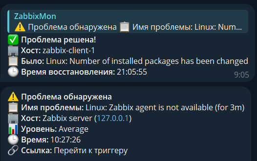

# Ansible-стенд мониторинга: Nginx + Zabbix 7.0 + Grafana

Инфраструктура мониторинга разворачивается одной командой `ansible-playbook site.yml`.

## Стенд

| Машина | IP | Роль |
|---|---|---|
| zabbix-server | <ZABBIX_SERVER_IP> | Ubuntu, PostgreSQL, Zabbix Server 7.0, веб-интерфейс (Apache, порт 80), Grafana (порт 3000) |
| zabbix-client-1 | <CLIENT_IP> | Ubuntu, Nginx 1.24 (со stub_status), Zabbix Agent2 |

Zabbix Server опрашивает агентов по порту 10050 (пассивные проверки);
агент клиента забирает метрики Nginx через `http://127.0.0.1/basic_status`.
На сервере развёрнута Grafana поверх Zabbix: плагин alexanderzobnin-zabbix-app,
datasource создаётся автоматическим provisioning-файлом (учётка read-only из vault),
дашборд `Nginx traffic` с метриками connections/requests.

## Структура проекта

    site.yml                  # точка входа: роли по хостам из inventory.ini
    inventory.ini             # хосты и группы
    group_vars/all.yml        # переменные (в т.ч. пароли БД и Grafana/Zabbix API, зашифрованы ansible-vault)
    roles/common              # базовая настройка хостов
    roles/nginx               # установка Nginx, конфиг со stub_status (/basic_status, allow 127.0.0.1)
    roles/zabbix_agent        # Zabbix Agent2, конфиг: Server=<IP сервера>,127.0.0.1
    roles/zabbix_server       # PostgreSQL + zabbix-server-pgsql + frontend (Apache),
                              # создание БД/пользователя, импорт схемы, снос лишнего Nginx
    roles/grafana             # установка Grafana, плагин Zabbix, provisioning datasource,
                              # пароль admin на первый запуск

## Запуск

    ansible-playbook site.yml

Плейбук идемпотентен: безопасно перезапускается, импорт схемы БД выполняется
только при первом создании базы (условие по результату createdb).

## Что мониторится

| Хост | Шаблоны |
|---|---|
| zabbix-server | Linux by Zabbix agent, Zabbix server health |
| zabbix-client-1 | Linux by Zabbix agent, Nginx by Zabbix agent |

Метрики Nginx: Connections active / accepted / handled / dropped per second,
requests — забираются агентом со stub_status. Дашборд `Nginx monitoring`:
график connections, виджет Connections active, виджет Problems.

## Grafana

Открывается на `http://<ZABBIX_SERVER_IP>:3000`, логин `admin`, пароль задаётся
в vault (`grafana_admin_password`). Datasource Zabbix поднимается provisioning-ом
(`/etc/grafana/provisioning/datasources/`) с учётной записью read-only:
API-юзер `grafana-reader` создаётся в Zabbix заранее. Дашборд `Nginx traffic`
строится по datasource Zabbix: connections accepted per second и requests per second.

## Проверка

    # порт агента
    ssh root@<CLIENT_IP> 'ss -tlnp | grep 10050'
    # метрики Nginx глазами агента
    ssh root@<CLIENT_IP> 'zabbix_agent2 -t web.page.get["127.0.0.1","/basic_status","80"]'
    # нагрузочный тест для графика
    ssh root@<CLIENT_IP> 'for i in $(seq 1 100); do curl -s http://127.0.0.1/ > /dev/null & done; wait'
    # Grafana datasource: Save & Test в UI Connections -> Data sources -> Zabbix

## Грабли, которые собрались по ходу

- **Порт 80 занят Nginx с прошлой лабы** — Apache не стартовал (Address already in use).
  Решение: роль zabbix_server сносит пакет `nginx` с purge; порт 80 отдаём Apache.
- **`POSTgreSQL` вместо `POSTGRESQL`** — опечатка в шаблоне zabbix.conf.php ловится
  валидатором веб-интерфейса; правка вносится в исходник роли, а не на сервер.
- **Порт в интерфейсе хоста 10051 вместо 10050** — агент не отвечает, ZBX серый.
- **`Server=` без `127.0.0.1`** — локальный агент на сервере отсекает опрос
  с localhost, красный ZBX; в конфиге агента через запятую добавлен 127.0.0.1.
- **DROP DATABASE при живых сессиях** — перед дропом старой БД останавливается
  zabbix-server.
- **`grafana-cli` без `--homepath`** — установка плагина падает с «Could not find
  config defaults»; вызов `grafana-cli --homepath /usr/share/grafana plugins install ...`.
- **Опечатка в IP агента (Server= вместо реального адреса сервера)** — агент жив,
  слушает 10050, но рвёт соединения: `Connection reset by peer` в вебморде.
  Симптом не указывает на конфиг — проверять grep'ом конфига агента.

## Скриншоты

