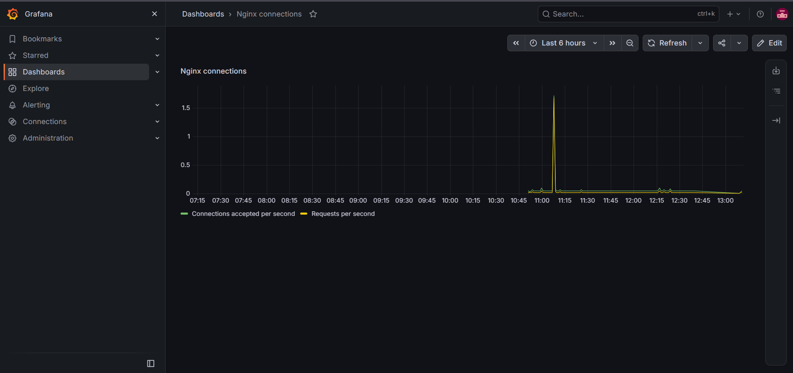

# Ansible Monitoring Lab

Стенд мониторинга, разворачиваемый одной командой Ansible:

- **zabbix-server** (31.59.169.57) — Zabbix Server, вебморда, Grafana с плагином Zabbix, Nginx с `stub_status`
- **zabbix-client-1** (80.247.208.223) — Zabbix Agent 2 + Nginx, метрики которого собираются

Управление — из WSL (Ansible control node), цель — воспроизводимый деплой мониторинга с нуля.

## Что показывает стенд

1. Grafana дашборд с метриками Nginx (connections/requests per second) поверх Zabbix
2. Сбор метрик через Zabbix Agent 2 и web-метрики `stub_status`
3. Проблемы и триггеры в Zabbix UI

Скриншот дашборда: 

## Быстрый старт

```bash
cd ~/ansible-monitoring-lab
ansible-playbook site.yml
```

Секреты лежат в зашифрованном vault: `group_vars/all.yml` (редактирование — `ansible-vault edit group_vars/all.yml`).

## Грабли, на которые наступил

1. **Плейсхолдеры в шаблонах вместо Jinja-переменных.** В шаблон Nginx уехал литеральный `<ZABBIX_SERVER_IP>` — reload падал с `invalid parameter "<ZABBIX_SERVER_IP>"`. Правило: плейсхолдеры — только в README и `inventory.ini.example`, во всех шаблонах ролей — `{{ переменные }}` из vault/инвентаря.
2. **`grafana-cli` без `--homepath`.** Свежая Grafana при запуске CLI из произвольной директории падает с `Could not find config defaults`. Лечение: `grafana-cli --homepath /usr/share/grafana plugins install ...`.
3. **`GF_SECURITY_ADMIN_PASSWORD` применяется только при первом старте.** Если Grafana стартовала раньше таска, пароль не применится. Надёжный путь — сброс через CLI: `grafana cli --homepath /usr/share/grafana --config /etc/grafana/grafana.ini admin reset-admin-password '<пароль>'`.
4. **Опечатка в IP в конфиге агента.** `Server=31.59.167.57` вместо `31.59.169.57` не даёт ошибок конфигурации — агент просто рвёт соединения (`Connection reset by peer`), а сервер помечает его Not available. Диагностика: лог агента (`connection rejected, allowed hosts: ...`) сразу показывает расхождение адресов.
5. **Блокировка юзера Zabbix при неудачных попытках входа API.** После серии промахов Zabbix лочит учётку на ~30 секунд — при отладке datasource ждать минуту перед ретраем.

## Структура

- `inventory.ini` — хосты и переменные подключения
- `group_vars/all.yml` — vault с секретами (IP, пароли БД/API/Grafana)
- `roles/` — роли zabbix-server, zabbix-agent, nginx, grafana
- `docs/` — скриншоты стенда
