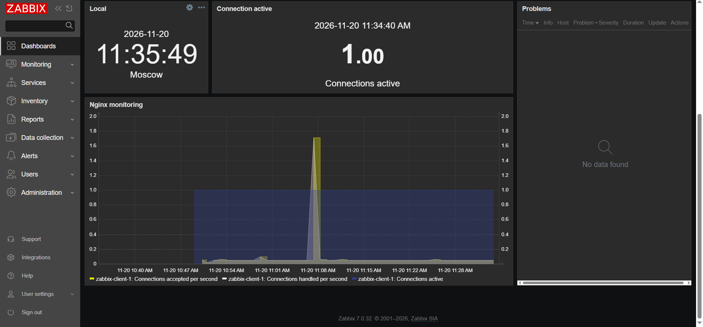

# Ansible + Zabbix: инфраструктура мониторинга с нуля

Стенд разворачивается одной командой `ansible-playbook site.yml`: базовая подготовка двух серверов,
Nginx со включённым `stub_status`, Zabbix Agent 2 на обеих машинах, Zabbix Server 7.0 + PostgreSQL
+ веб-интерфейс на управляющем сервере.

## Схема стенда

```
+---------------------------+          +---------------------------+
|  zabbix-server            |          |  zabbix-client-1          |
|  <ZABBIX_SERVER_IP>             |          |  <CLIENT_IP>           |
|                           |          |                           |
|  - Zabbix Server :10051   | <------> |  - Zabbix Agent 2 :10050  |
|  - PostgreSQL             |  10050   |  - Nginx :80              |
|  - Apache + UI /zabbix    |  agent   |    /basic_status          |
|  - Zabbix Agent 2 :10050  |  polls   |  (stub_status, allow 127.0.0.1)|
+---------------------------+          +---------------------------+
```

- Пассивные проверки: сервер опрашивает агентов по порту **10050** (не путать с 10051 — это порт самого сервера).
- Nginx-метрики агент забирает с `http://127.0.0.1/basic_status` (шаблон **Nginx by Zabbix agent**, макросы `{$NGINX.STUB_STATUS.*}`).

## Структура проекта

```
.
├── site.yml                        # главный плейбук, 4 play
├── inventory.ini                   # хосты и группы
├── group_vars/
│   └── all.yml                     # IP сервера, путь stub_status, реквизиты БД
├── roles/
│   ├── common/                     # базовая подготовка: обновления, время, утилиты
│   ├── nginx/
│   │   ├── tasks/main.yml          # установка Nginx + vhost со stub_status
│   │   ├── templates/
│   │   │   └── stub_status.conf.j2 # location /basic_status { stub_status; allow 127.0.0.1; }
│   │   └── handlers/main.yml
│   ├── zabbix_agent/
│   │   ├── tasks/main.yml          # репо Zabbix 7.0 + zabbix-agent2
│   │   ├── templates/
│   │   │   └── zabbix_agent2.conf.j2  # Server={{ zabbix_server_ip }},127.0.0.1
│   │   └── handlers/main.yml
│   └── zabbix_server/
│       ├── tasks/main.yml          # PostgreSQL + zabbix-server-pgsql + frontend
│       ├── templates/
│       │   └── zabbix.conf.php.j2  # конфиг веб-интерфейса ($DB['TYPE'] = 'POSTGRESQL')
│       └── handlers/main.yml
└── README.md
```

## Запуск

```bash
ansible-playbook site.yml
```

Идемпотентность: повторный прогон ничего не ломает. Ключевые защиты в роли `zabbix_server`:

- создание пользователя БД — `failed_when: false` (пользователь уже существует — ок);
- импорт схемы — только при первом создании БД (`register` + `when: createdb_result.changed`), повторный импорт в живую базу не выполняется;
- Nginx с прошлого стенда сносится с сервера Zabbix (`state: absent, purge: true`), чтобы не держал порт 80.

## Настройка в веб-интерфейсе (ручной шаг)

`http://<ZABBIX_SERVER_IP>/zabbix`, логин `Admin` / `zabbix`, затем:

| Хост | Интерфейс | Шаблоны |
|---|---|---|
| `zabbix-server` | Agent, `127.0.0.1:10050` | Linux by Zabbix agent, Zabbix server health |
| `zabbix-client-1` | Agent, `<CLIENT_IP>:10050` | Linux by Zabbix agent, Nginx by Zabbix agent |

Имена хостов в UI обязаны совпадать с `Hostname=` в конфиге агента (в роли — `inventory_hostname`).

Дашборд: Graph с метриками `Connections accepted/handled per second` и `Connections active`,
виджет Item value для `Connections active`, виджет Problems.

## Скриншоты

### Дашборд Nginx monitoring (пик нагрузки — 100 одновременных запросов)



## Проверка

```bash
# оба агента живы и представляются правильными именами
ssh root@<ZABBIX_SERVER_IP>    'zabbix_agent2 -t agent.hostname'
ssh root@<CLIENT_IP>  'zabbix_agent2 -t agent.hostname'

# Nginx отдаёт stub_status
ssh root@<CLIENT_IP> 'curl -s http://127.0.0.1/basic_status'

# агент видит Nginx
ssh root@<CLIENT_IP> 'zabbix_agent2 -t web.page.get["127.0.0.1","/basic_status","80"]'
```

## Грабли, которые собрали по пути

1. **Порт 80 занят Nginx с прошлой лабы** — Apache не мог забиндиться (`Address already in use`).
   Лечится задачей на purge Nginx в роли `zabbix_server`.
2. **Опечатка в типе БД** — веб-интерфейс честно сказал `Incorrect value "POSTgreSQL"`.
   Правится в шаблоне роли, накатывается повторным прогоном плейбука.
3. **Неправильный порт агента в UI** — интерфейс хоста был `10051` вместо `10050`,
   из-за чего ZBX висел серым.
4. **Агент сервера не пускал localhost** — в `Server=` добавлен `127.0.0.1`.
5. **Старая БД от прошлого прогона** — перед чистым развёртыванием базу дропают
   (Zabbix-сервер предварительно останавливается, иначе PostgreSQL не отдаст базу: `database is being accessed by other users`).

## Стек

Ansible 2.17, Zabbix 7.0 (server-pgsql, agent2, frontend), PostgreSQL, Nginx, Apache, Ubuntu 24.04.
